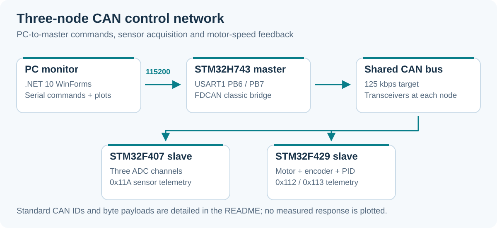

# STM32 CAN Bus Network

**A three-node CAN experiment with sensor acquisition, DC motor PID control and a Windows monitor.**

STM32H743 / F407 / F429 · Classic CAN · C / HAL · C# WinForms / .NET 10 · ScottPlot

<a id="english"></a>

**English** · [Tiếng Việt](#tieng-viet)

The H743 master bridges UART commands from a PC into the CAN network. An F407 slave streams three ADC channels, while an F429 slave controls a DC motor using software PWM and an encoder-based PID loop. The WinForms application exposes the bus log, motor controls and a PID tuning window.



*Architecture derived from the three firmware projects and GUI code.*

## Node roles

| Node | Implementation |
|---|---|
| Master H743 | FDCAN1 in classic mode, standard identifiers; serial command parser and CAN-to-UART logging |
| Slave F407 | bxCAN1, three-channel ADC acquisition and peer button messages |
| Slave F429 | bxCAN1, TIM3 software PWM on PE2/PE3, encoder TIM4 on PD12/PD13, PID speed loop |
| PC | COM-port monitor, ADC/motor status, gains/target/CPR controls, plots and CSV export |

The documented CAN target is **125 kbps**. UART uses **115200 baud**. F429 updates speed/PID on a nominal **10 ms** schedule, emits PID telemetry every **50 ms** and motor telemetry every **100 ms**. These are configured intervals rather than measured response benchmarks.

## Repository layout

```text
STM32-CAN-Network/
├── MCU/
│   ├── Master_H743_Ver_1/       # Master FDCAN/UART bridge
│   ├── SLAVE_F407_Ver_2/        # Sensor/ADC slave
│   └── SLAVE_F429_Ver_2/        # Motor/encoder/PID slave
├── GUI/CANBusMonitor/           # Form1 monitor and FormPID tuner
├── Documents/                 # Test plan, GUI notes and board references
└── docs/images/               # README network diagram
```

## Connections and prerequisites

| Interface | Pin assignment in current firmware |
|---|---|
| H743 USART1 | **PB6 TX, PB7 RX**, 115200 baud |
| H743 FDCAN1 | PD0 RX, PD1 TX to its CAN transceiver |
| F407/F429 CAN1 | PD0 RX, PD1 TX to each node's transceiver |
| F429 encoder | PD12 / TIM4_CH1 and PD13 / TIM4_CH2 |
| F429 motor control | PE2/PE3 drive inputs; PA6 enable |

Connect each node through a suitable CAN transceiver to the shared CAN_H/CAN_L bus, with a common reference and 120-ohm termination at the two physical ends. UART adapter TX connects to master **PB7 RX**, and adapter RX connects to **PB6 TX**.

Older documentation mentions PB14/PB15, but both the committed `.ioc` and active GPIO setup select **PB6/PB7**. Match your actual board revision to those source files before wiring.

Tools: **STM32CubeIDE/ST-Link** for the firmware; **Windows and a .NET 10-compatible SDK/Visual Studio** for the desktop app. The GUI project targets `net10.0-windows`, with `System.IO.Ports` 10.0.7 and ScottPlot.WinForms 5.0.

## Build and run

```bash
git clone https://github.com/TuanLinh05/STM32-CAN-Network.git
```

1. Import each existing project from `MCU/` into STM32CubeIDE.
2. Review its `.ioc`, target device, CAN clock/bit timing and transceiver wiring.
3. Build and flash each image to its corresponding MCU.
4. Connect the master's UART adapter to the Windows PC.
5. Restore and start the GUI:

   ```powershell
   dotnet restore GUI/CANBusMonitor/CANBusMonitor.csproj
   dotnet run --project GUI/CANBusMonitor/CANBusMonitor.csproj
   ```

6. Refresh/select the COM port and click **Connect**. Start with **Ping** and ADC acquisition, then use the motor/PID controls with matching encoder CPR.

F429 defaults to **1500 encoder counts/revolution**, PID gains `Kp=0.05`, `Ki=0.01`, `Kd=0`, target zero and PID disabled. Set CPR for the actual encoder/gearing before interpreting RPM.

## Protocol reference

### CAN identifiers

| ID | Producer / recipient | Current purpose |
|---|---|---|
| `0x010` | Master -> F407 | LED, ADC start and stop command bytes |
| `0x020` | Master -> F429 | Motor/PID command bytes |
| `0x111` | F407 -> F429 | Peer button event |
| `0x112` | F429 -> network | One-byte peer event or six-byte motor telemetry |
| `0x113` | F429 -> master | Eight-byte PID telemetry |
| `0x11A` | F407 -> master | Three-channel ADC values |

Interpret `0x112` by payload length as well as ID. The earlier GUI guide's separate `0x030/0x031/0x040` command IDs do not match this firmware's command-byte protocol.

### UART commands from PC

Frames are ASCII strings enclosed in `<` and `>`. The GUI appends a newline.

| Frame | Meaning |
|---|---|
| `<CMD_PING>` | Connection greeting |
| `<CMD_START_ADC>` / `<CMD_STOP_ADC>` | Enable/disable F407 streaming |
| `<PWM_FWD_50>` / `<PWM_REV_50>` | Manual direction and duty percentage |
| `<PWM_BRAKE>` / `<PWM_STOP>` | Brake / coast |
| `<PID_SET:5,1,0>` | Gains encoded as integers multiplied by 100: 0.05, 0.01, 0 |
| `<PID_TARGET:100>` | Target speed in RPM |
| `<PID_CPR:1500>` | Encoder counts per revolution |
| `<PID_START>` / `<PID_STOP>` | Enable/disable closed-loop control |

Master-to-motor command payloads use `0x10/0x11/0x12/0x13` for manual drive/brake/coast and `0x20`-`0x24` for gains, target, start, stop and CPR. Multi-byte command values are serialized high byte first.

### UART telemetry to PC

```text
<ADC_3CH:v1,v2,v3>
<MOTOR_SPD:rpm,dir,duty,encoder_count>
<PID_DATA:target,actual,error,output>
```

These show the message formats, not recorded measurements. The master decodes CAN payloads and prints text; the GUI parses the corresponding lines for display. PID telemetry contains integer-rounded fields and duty/output percentages.

## PID tuning and troubleshooting

The tuning window supports gains, target RPM, encoder CPR, PID start/stop, step-response display and CSV export. A real response depends on the motor, load, driver and encoder configuration.

| Symptom | Check |
|---|---|
| No PC greeting | PB6/PB7 wiring, 115200 baud, COM ownership and master image |
| UART works but no CAN traffic | Transceivers, termination, bitrate, IDs and interrupts |
| ADC buttons have no effect | Slave F407 image and `0x010` command-byte handling |
| Motor RPM wrong | Encoder PD12/PD13, counts/revolution, gearing and direction |
| FWD/REV ignored while PID runs | Stop PID first; BRAKE and COAST explicitly disable PID |
| GUI build fails | Windows target, .NET 10 SDK and restored NuGet packages |
| Guide and firmware disagree | Use the current parser and slave switch statements as the protocol reference |

Source: [master parser](MCU/Master_H743_Ver_1/Core/Src/main.c), [motor slave](MCU/SLAVE_F429_Ver_2/Core/Src/main.c), [sensor slave](MCU/SLAVE_F407_Ver_2/Core/Src/main.c), [GUI](GUI/CANBusMonitor/Form1.cs), [PID window](GUI/CANBusMonitor/FormPID.cs).

Background: [CAN test plan](Documents/New_CAN_Test_Plan.md) and [earlier GUI guide](Documents/GUI_User_Guide.md). Some guide details describe older revisions.

---

<a id="tieng-viet"></a>

## Tiếng Việt

[English](#english) · **Tiếng Việt**

Mạng CAN ba node: **H743 master** làm cầu nối UART/CAN, **F407** đọc ADC ba kênh, **F429** điều khiển động cơ bằng PWM, encoder và PID. GUI C# WinForms hiển thị log, dữ liệu ADC/motor và cửa sổ tuning.

### Khởi chạy

1. Nối các MCU qua transceiver vào CAN_H/CAN_L, chung reference và điện trở 120 ohm tại hai đầu bus.
2. Import, build và nạp đúng ba project trong `MCU/` bằng STM32CubeIDE/ST-Link.
3. UART master hiện dùng **PB6 TX/PB7 RX**, baud **115200**; TX USB-TTL vào PB7, RX USB-TTL vào PB6. Tài liệu cũ ghi PB14/PB15 chưa khớp `.ioc` và code hiện tại.
4. Chạy `GUI/CANBusMonitor` trên Windows với **.NET 10**, restore NuGet, chọn COM và **Connect**.
5. Thử Ping/ADC trước, sau đó chỉnh CPR, target và PID theo động cơ thật.

CAN đặt mục tiêu 125 kbps; vòng speed/PID F429 có lịch 10 ms, PID telemetry 50 ms, motor telemetry 100 ms. CPR mặc định **1500**, PID ban đầu tắt. Các tốc độ này là cấu hình trong code.

### Giao thức

Master dùng ID `0x010` cho lệnh F407, `0x020` cho F429. Telemetry ADC là `0x11A`, motor `0x112`, PID `0x113`. `0x112` còn có event một byte nên phải xem DLC. Các ID `0x030/0x031/0x040` trong hướng dẫn cũ không phải giao thức hiện tại.

UART có các lệnh `<CMD_START_ADC>`, `<PWM_FWD_50>`, `<PWM_STOP>`, `<PID_TARGET:100>`, `<PID_CPR:1500>`, `<PID_START>`, `<PID_STOP>`. Gain trong `<PID_SET:5,1,0>` là số nguyên nhân 100, tương ứng **0.05, 0.01, 0**. Xem [bảng protocol](#protocol-reference) để tra đầy đủ.

Encoder dùng PD12/PD13; driver motor dùng PE2/PE3 và PA6 enable. Tuning/step-response cần dữ liệu từ bộ motor/encoder thực, chưa có benchmark hiệu năng trong README. Xem [test plan](Documents/New_CAN_Test_Plan.md), [FormPID](GUI/CANBusMonitor/FormPID.cs) và [code master](MCU/Master_H743_Ver_1/Core/Src/main.c).

---

Developed by [Vu Tuan Linh](https://github.com/TuanLinh05) · HCMUT.
